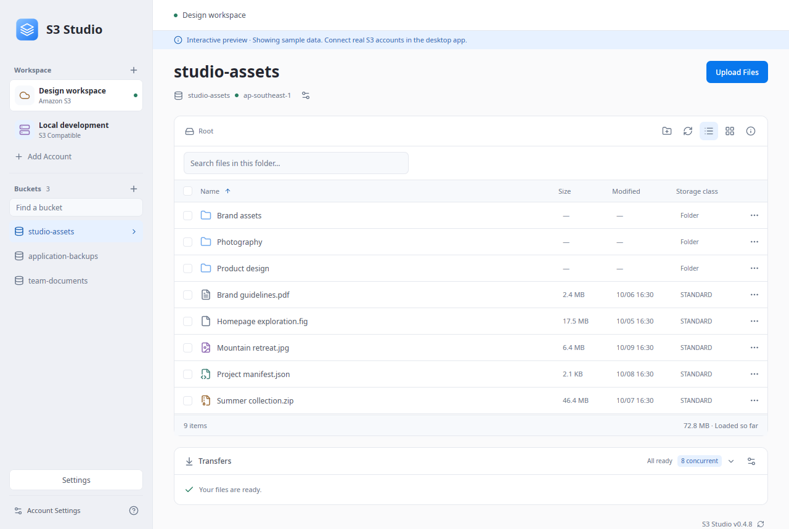

# S3 Studio

[简体中文](README.md) · [English](README.en.md) · [한국어](README.ko.md) · [日本語](README.ja.md) · [Français](README.fr.md) · [Deutsch](README.de.md) · [Русский](README.ru.md)

S3 Studio est un client S3 de bureau multiplateforme pour gérer vos fichiers cloud dans un espace de travail clair. Connectez AWS S3, MinIO ou d’autres services compatibles S3, gérez plusieurs comptes, parcourez vos compartiments et transférez vos fichiers. Le nombre de comptes est illimité et les identifiants restent dans le trousseau système.



## Fonctionnalités

- Comptes multiples avec Endpoint personnalisé, Region, adressage par chemin et identifiants temporaires.
- Navigation par dossiers et fil d’Ariane, recherche, tri, vues liste et grille, sélection multiple et détails des objets.
- Téléversement, téléchargement, création de dossiers et compartiments, copie dans un même compartiment, suppression multiple et liens signés.
- Progression et vitesse des transferts, pause, reprise, nouvel essai et reprise après redémarrage.
- Limite de concurrence partagée entre les comptes : 8 par défaut, réglable de 1 à 32.
- Thèmes système, clair et sombre ; chinois, anglais, coréen, japonais, français, allemand et russe.
- Identifiants enregistrés dans macOS Keychain, Windows Credential Manager ou Linux Secret Service.

## Téléchargement et installation

Téléchargez la dernière version sur [GitHub Releases](https://github.com/eyotang/s3studio/releases/latest). Vérifiez les fichiers avec le `SHA256SUMS.txt` de la version avant l’installation.

| Plateforme                      | Paquet           | Installation                                        |
| ------------------------------- | ---------------- | --------------------------------------------------- |
| macOS 14+ Apple Silicon / Intel | Universal `.dmg` | Glisser S3 Studio dans Applications                 |
| Windows x64                     | `.exe` / `.msi`  | Exécuter le programme d’installation                |
| Ubuntu 22.04+ amd64             | `.deb`           | Ouvrir avec l’installateur du système               |
| Linux x86_64                    | `.AppImage`      | Autoriser l’exécution puis lancer                   |
| Omarchy / Arch Linux x86_64     | `.pkg.tar.zst`   | Utiliser `sudo pacman -U` suivi du chemin du paquet |

### Si macOS refuse d’ouvrir l’application

L’application macOS est signée avec Apple Developer ID, mais n’est pas encore notarisée. Déplacez l’application dans Applications, vérifiez la source officielle et le SHA-256, puis exécutez :

```bash
sudo xattr -d com.apple.quarantine "/Applications/S3 Studio.app"
```

Sous Linux, démarrez et déverrouillez un trousseau Secret Service, par exemple GNOME Keyring, et prévoyez le portail de sélection de fichiers du bureau. Autorisez l’exécution de l’AppImage dans ses propriétés. Le paquet Omarchy n’est pas dans AUR : téléchargez les nouveaux paquets et mettez à jour avec `pacman -U`. La désinstallation par `sudo pacman -R s3-studio` conserve les réglages personnels.

## Prise en main

### Connecter un compte

Choisissez Ajouter un compte, puis indiquez le nom, Access Key ID, Secret Access Key et Region. Pour AWS, Endpoint est généralement inutile et la région du compartiment est détectée automatiquement. Les identifiants temporaires exigent aussi Session Token. Exemple MinIO : Endpoint `http://localhost:9000`, Region `us-east-1`, adressage par chemin activé. Utilisez HTTPS en production.

Le compte doit disposer des permissions S3 nécessaires. Double-cliquez sur un dossier pour l’ouvrir ou sur un fichier pour afficher ses détails. Sélectionnez des objets pour télécharger, copier, partager ou supprimer. Supprimer un dossier supprime tout son contenu après confirmation. Les téléversements écrasent les objets de même nom. Les liens sont valables 1 heure, éventuellement moins si les identifiants temporaires expirent.

### Langue, thème et transferts

Ouvrez Réglages dans la barre latérale ou, sur macOS, S3 Studio → Réglages… (⌘,). Langue et thème s’appliquent immédiatement et sont enregistrés localement. Selon le système détecte les langues prises en charge et utilise l’anglais par défaut. Réglez la concurrence de 1 à 32 puis enregistrez. La barre de titre native macOS suit le thème choisi.

La section Transferts permet de mettre en pause, reprendre, réessayer ou annuler. Les parties terminées sont conservées en pause. Après redémarrage, les transferts inachevés restent en pause jusqu’à une reprise manuelle. L’annulation nettoie les points de reprise et les fichiers temporaires. Une modification de la source, de l’objet distant ou de la destination peut empêcher une reprise ou un écrasement dangereux.

### Mises à jour et limites

Recherchez les mises à jour depuis le menu macOS ou le numéro de version. Les versions publiées vérifient après 20 secondes, puis toutes les 24 heures. Windows NSIS/MSI et Linux AppImage prennent en charge l’installation vérifiée dans l’application ; terminez ou mettez d’abord les transferts en pause. macOS et deb ouvrent la page des versions pour une installation manuelle. Comptes et points de reprise sont conservés.

Le menu **Actions sur les fichiers** propose les transferts récursifs, la copie et le déplacement entre compartiments et comptes, le renommage, les aperçus, l’édition locale, la synchronisation unidirectionnelle, les filtres, le partage groupé et les propriétés des objets. Vous pouvez télécharger ou supprimer les versions sélectionnées. La limite d’envoi est de 5 Tio par fichier. SSO/AssumeRole, la gestion des ACL et des politiques de compartiment, la récupération Glacier et l’administration CloudFront restent hors de cette version.

## Développement et contribution

L’application utilise Native Shell, Rust et AWS SDK for Rust. `src-nsh` contient l’interface native et sa configuration d’empaquetage. `src-core` contient le backend. Installez Rust stable ainsi que Xcode Command Line Tools sur macOS ou MSVC C++ Build Tools sur Windows. Les bibliothèques Linux figurent dans la [référence de développement](README.md#开发与贡献).

```bash
cargo run --locked --manifest-path src-nsh/Cargo.toml
```

Ajoutez `-- --preview` pour ouvrir l’application avec des données d’exemple.

Exécutez les vérifications adaptées à vos modifications :

```bash
cargo test --locked --manifest-path src-core/Cargo.toml
cargo test --locked --manifest-path src-nsh/Cargo.toml
node --test tests/release-manifest.test.mjs
```

Exécutez `node scripts/build-native.mjs` puis `node scripts/package-native.mjs` sur le système cible. Les scripts d’empaquetage et de publication utilisent Node.js 22.12+ et sa bibliothèque standard. Consultez la [référence de développement](README.md#开发与贡献) pour les builds Universal, les chemins de données et les signatures. Modifiez les traductions dans `src-core/locales`, exécutez `node scripts/sync-i18n.mjs`, formatez Rust puis testez.

Dans les issues, indiquez version, système, étapes de reproduction et erreurs. Retirez identifiants et données privées des journaux et captures. Les pull requests doivent expliquer le problème, le comportement obtenu et les vérifications ; ajoutez des captures pour les changements d’interface. Les tests utilisent un simulateur S3 local. Pour publier, suivez [AGENTS.md](AGENTS.md) : notes en anglais d’abord, puis en chinois, avec les instructions macOS xattr dans les deux langues.

Ce projet indépendant n’est pas un produit officiel AWS. Voir la [référence technique en chinois](README.md), les [notes de version](docs/releases) et les [ressources de marque](assets/brand).
