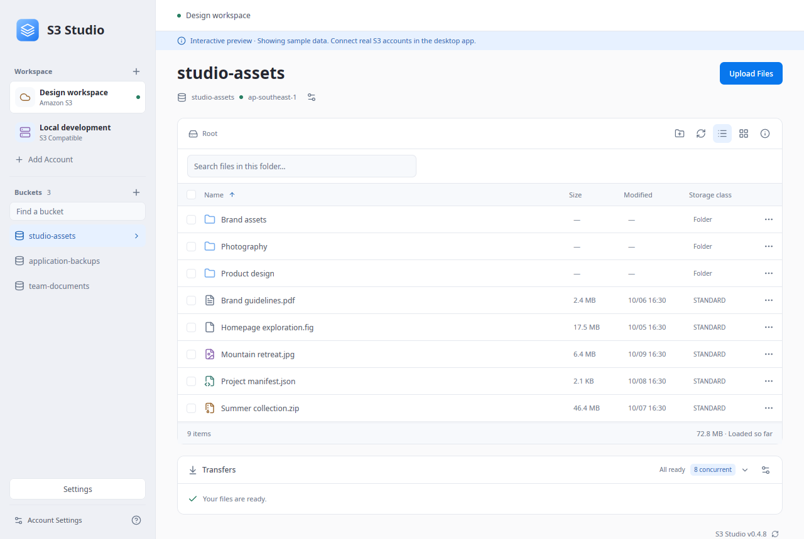

# S3 Studio

[简体中文](README.md) · [English](README.en.md) · [한국어](README.ko.md) · [日本語](README.ja.md) · [Français](README.fr.md) · [Deutsch](README.de.md) · [Русский](README.ru.md)

S3 Studioは、クラウド上のファイルをひとつの見やすいワークスペースで管理できる、クロスプラットフォームのデスクトップS3クライアントです。AWS S3、MinIOなどのS3互換サービスに接続し、複数アカウントやバケットの管理、アップロード、ダウンロードを行えます。アカウント数は無制限で、認証情報はシステムのキーチェーンに保存されます。



## 主な機能

- カスタムEndpoint、Region、パス形式、一時認証情報に対応した複数アカウント管理。
- フォルダー移動、パンくず、検索、並べ替え、リスト・グリッド表示、複数選択、オブジェクトの詳細。
- アップロード、ダウンロード、フォルダー・バケット作成、同一バケット内コピー、一括削除、署名付きリンクの共有。
- 転送進捗・速度、一時停止、再開、再試行、アプリ再起動後の再開。
- 全アカウントで共有する並列数。既定は8、1～32に変更可能。
- システム・ライト・ダークテーマと、中国語、英語、韓国語、日本語、フランス語、ドイツ語、ロシア語。
- macOS Keychain、Windows Credential Manager、Linux Secret Serviceに認証情報を保存。

## ダウンロードとインストール

[GitHub Releases](https://github.com/eyotang/s3studio/releases/latest)から最新版をダウンロードし、インストール前にリリース付属の `SHA256SUMS.txt` で検証してください。

| プラットフォーム                | パッケージ       | インストール方法                                  |
| ------------------------------- | ---------------- | ------------------------------------------------- |
| macOS 14+ Apple Silicon / Intel | Universal `.dmg` | S3 Studioをアプリケーションへドラッグ             |
| Windows x64                     | `.exe` / `.msi`  | インストーラーを実行                              |
| Ubuntu 22.04+ amd64             | `.deb`           | システムのパッケージインストーラーで開く          |
| Linux x86_64                    | `.AppImage`      | 実行権限を付与して起動                            |
| Omarchy / Arch Linux x86_64     | `.pkg.tar.zst`   | `sudo pacman -U` とパッケージのパスでインストール |

### macOSでアプリを開けない場合

macOSアプリはApple Developer IDで署名されていますが、Appleの公証はまだ行っていません。アプリを「アプリケーション」に移し、公式リリースの配布元とSHA-256を確認してから、次を実行してください：

```bash
sudo xattr -d com.apple.quarantine "/Applications/S3 Studio.app"
```

LinuxではGNOME KeyringなどのSecret Service対応キーリングを起動してロックを解除し、デスクトップのファイル選択ポータルを用意してください。AppImageはファイルのプロパティで実行を許可します。OmarchyのパッケージはAUR未登録のため、新しいパッケージをダウンロードし `pacman -U` で更新します。`sudo pacman -R s3-studio` で削除しても個人設定は残ります。

## 使いはじめる

### アカウントを接続

「アカウントを追加」で名前、Access Key ID、Secret Access Key、Regionを入力します。AWSでは通常Endpointは不要で、バケットのリージョンは自動検出されます。一時認証情報にはSession Tokenも必要です。MinIOの例：Endpointは `http://localhost:9000`、Regionは `us-east-1`、パス形式を有効化。本番環境ではHTTPSを使用してください。

操作に応じたS3権限が必要です。フォルダーをダブルクリックして移動し、ファイルをダブルクリックすると詳細を表示します。オブジェクトを選択してダウンロード、コピー、共有、削除できます。フォルダーの削除は確認後に全内容を再帰削除します。アップロードは同名オブジェクトを上書きします。共有リンクは1時間有効ですが、一時認証情報の期限により早く失効する場合があります。

### 言語・テーマ・転送

サイドバーの「設定」、またはmacOSの「S3 Studio → 設定…」（⌘,）を開きます。言語とテーマはすぐに反映され、ローカルに保存されます。「システムに従う」は対応するシステム言語を検出し、それ以外は英語を使います。並列数は1～32に設定し「設定を保存」を押します。macOSのネイティブタイトルバーも選択したテーマに従います。

「転送状況」で一時停止、再開、再試行、キャンセルができます。一時停止では完了済みパートを保持します。再起動後も未完了の転送は手動で再開するまで停止したままです。キャンセル時には再開情報と一時データを消去します。元ファイル、リモートオブジェクト、保存先の変更を検出すると、安全でない再開や上書きを防ぎます。

### 更新と制限

macOSのアプリメニューまたはバージョン表示から更新を確認できます。リリース版は起動20秒後、その後24時間ごとに確認します。Windows NSIS/MSIとLinux AppImageでは検証済み更新をアプリ内でインストールできます。先に全転送を完了または一時停止してください。macOSとdebはリリースページから手動インストールします。アカウントと再開情報は保持されます。

「ファイル操作」から、フォルダー転送、バケット・アカウント間のコピーと移動、名前変更、プレビュー、ローカル編集、片方向同期、絞り込み、一括共有、属性編集を利用できます。指定したバージョンのダウンロードと削除にも対応します。アップロードは1ファイル最大5 TiBです。SSO/AssumeRole、バケットの ACL・ポリシー編集、Glacier 取り出し、CloudFront 管理は対象外です。

## 開発とコントリビュート

Native Shell、Rust、AWS SDK for Rustを使用しています。`src-nsh` にはネイティブUIとパッケージ設定、`src-core` にはバックエンドがあります。安定版Rustと、macOSではXcode Command Line Tools、WindowsではMSVC C++ Build Toolsが必要です。Linuxの依存関係は[開発リファレンス](README.md#开发与贡献)を参照してください。

```bash
cargo run --locked --manifest-path src-nsh/Cargo.toml
```

`-- --preview` を追加すると、サンプルデータでデスクトップアプリを起動できます。

変更内容に応じて、次の検証を実行してください：

```bash
cargo test --locked --manifest-path src-core/Cargo.toml
cargo test --locked --manifest-path src-nsh/Cargo.toml
node --test tests/release-manifest.test.mjs
```

対象OSで `node scripts/build-native.mjs` と `node scripts/package-native.mjs` を実行します。パッケージ化とリリースにはNode.js 22.12以降の標準ライブラリを使用します。Universalビルド、保存先、更新署名は[開発リファレンス](README.md#开发与贡献)を参照してください。翻訳は `src-core/locales` を編集し、`node scripts/sync-i18n.mjs` を実行してRustを整形後、テストしてください。

Issueにはアプリのバージョン、OS、再現手順、エラーを記載してください。ログやスクリーンショットから認証情報や個人情報を取り除いてください。Pull Requestには問題、変更後の動作、検証結果を記載し、UI変更にはスクリーンショットを添付してください。テストは実際のクラウドアカウントではなくローカルS3シミュレーターを使用します。公開時は[AGENTS.md](AGENTS.md)に従い、説明を英語、次に中国語の順に記載し、両方にmacOSのxattr手順を含めます。

本プロジェクトは独立した実装であり、AWS公式製品ではありません。[中国語の技術リファレンス](README.md)、[リリースノート](docs/releases)、[ブランド素材](assets/brand)を参照してください。
