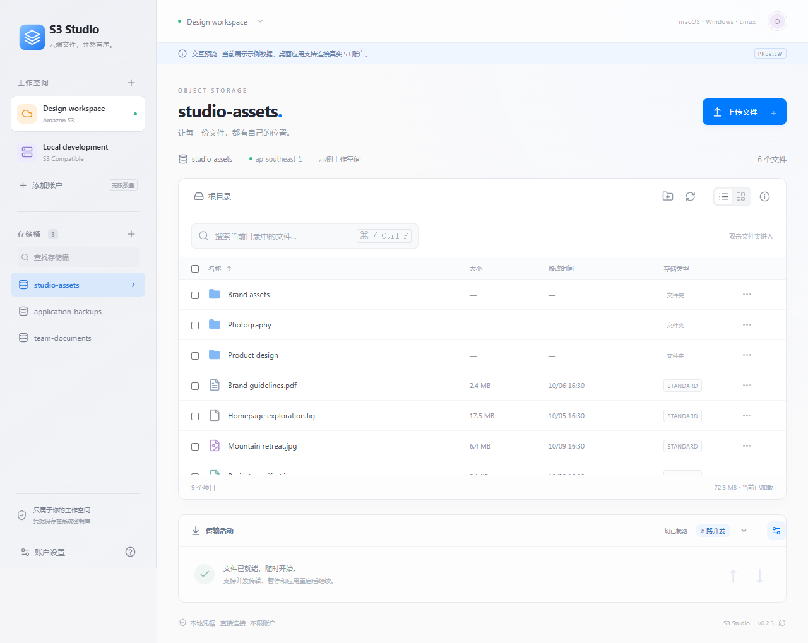

# S3 Studio

基于 **GPUI + GPUI Kit + Rust + AWS SDK for Rust** 的跨平台图形化 S3 客户端。以 Apple 的清晰层级、柔和材质、留白和原生交互为设计参考，支持 macOS、Ubuntu、Omarchy / Arch Linux 和 Windows，**账户数量不设上限**。



## 下载

在 [GitHub Releases](https://github.com/eyotang/s3studio/releases/latest) 下载 Windows x64（EXE / MSI）、macOS Universal（Apple Silicon / Intel，DMG）和 Ubuntu 22.04+ amd64（deb / AppImage）安装包。每次发布附带 `SHA256SUMS.txt`，可核对下载文件。

当前安装包未进行代码签名或 macOS 公证，系统可能提示来源无法验证。macOS 允许打开的选项位于系统设置「隐私与安全性」。Ubuntu 需要运行并解锁 Secret Service 密钥库，例如 GNOME Keyring。

### Omarchy / Arch Linux x86_64

下载 Release 中的 `S3-Studio_<版本>_omarchy_x86_64.pkg.tar.zst`，核对 SHA-256 后安装。例如 0.3.0 的补充包使用独立的 `SHA256SUMS-Omarchy.txt`：

```bash
sha256sum --ignore-missing -c SHA256SUMS-Omarchy.txt
sudo pacman -U ./S3-Studio_0.3.0_omarchy_x86_64.pkg.tar.zst
```

安装后从应用启动器打开 **S3 Studio**，也可运行 `s3-studio`。应用名称、ID、账户配置和系统密钥库与其他发行版一致；需要运行且解锁 Secret Service 密钥库（如 GNOME Keyring），以及桌面环境的文件选择 portal。卸载使用 `sudo pacman -R s3-studio`，不会删除个人账户和传输配置。

此包尚未加入 AUR 或 Omarchy 软件仓库。应用内继续检查原更新源，打开发布页下载新包，再用 `pacman -U` 升级。当前支持 x86_64；没有发布 ARM64 包。CI 使用 Arch Linux 容器验证安装、动态库、桌面入口、X11 / 原生 Wayland 窗口启动及卸载；没有覆盖所有 Omarchy 实机和显卡。

## 已实现

- 添加、编辑、切换和移除任意数量的账户。
- AWS S3 及自定义 Endpoint 的 S3 兼容服务；支持路径风格、Region 和临时 Session Token。
- 凭据通过 macOS Keychain、Windows Credential Manager、Ubuntu Secret Service 保存；前端不接收已保存的凭据，配置文件不存储访问密钥。
- 存储桶列表、创建存储桶、AWS 桶区域自动探测。
- 文件夹浏览、面包屑导航、新建文件夹、每页 1,000 项分页加载。
- 搜索当前已加载对象、按名称/大小/修改时间排序、列表与网格切换、多选。
- 并发分片上传：按文件偏移流式读取，不将整个文件放入内存；SDK 负责可重试请求的重试。
- 并发 Range 下载：各分片写入临时文件的不同区间，全部完成后才替换目标文件。
- 批量删除文件、同桶复制对象、生成 1 小时预签名下载链接。
- 对象大小、修改时间、Content-Type、ETag 和自定义元数据查看。
- 传输活动：进度、速度、暂停、继续、失败重试、取消及断点清理；应用重启后可手动继续。
- 应用级共享并发上限默认 **8 路**，支持 **1–32 路**，运行中可修改并自动保存。
- ⌘ / Ctrl + F 搜索、Escape 关闭弹窗/清除选择、弹窗焦点循环。
- Windows / macOS / Ubuntu 的 GitHub Actions 构建配置。

参考 [S3 Browser 的公开功能](https://s3browser.com/)，本项目采用独立实现，并非 AWS 官方产品。Tauri 配置和 IPC 依据 [Tauri 官方文档](https://v2.tauri.app/)，S3 请求由 [AWS 官方 Rust SDK](https://docs.aws.amazon.com/sdk-for-rust/latest/dg/welcome.html) 完成。

Logo 以 Apple Design 的克制、留白和几何层级为参考：保留浅蓝色圆角底，采用三层等距几何线条表达对象存储。侧栏、桌面与安装包使用同一标志。最终 SVG 源文件和设计说明位于 `assets/brand/`，应用内图标与 favicon 位于 `public/`，桌面 PNG / ICO / ICNS 位于 `src-tauri/icons/`。重新导出使用 `npm run tauri -- icon assets/brand/s3-studio-logo.svg`。

## 开发环境

- Node.js 22.12+（本机验证：22.23.1）。
- 最新稳定版 Rust（本机验证：1.97.0；原生依赖固定在 `src-gpui/Cargo.lock`，共享后端测试依赖固定在 `src-core/Cargo.lock`）。
- Windows：MSVC C++ Build Tools 和 WebView2。
- macOS：Xcode Command Line Tools。
- Ubuntu：以下原生开发依赖；桌面会话中需要运行且解锁支持 Secret Service 的密钥库，如 GNOME Keyring。

```bash
sudo apt-get update
sudo apt-get install -y build-essential curl wget file libwebkit2gtk-4.1-dev libxdo-dev libssl-dev librsvg2-dev libayatana-appindicator3-dev libdbus-1-dev gnome-keyring libxcb1-dev libxkbcommon-dev libxkbcommon-x11-dev libwayland-dev libvulkan-dev libfontconfig1-dev libasound2-dev libx11-xcb-dev libxi-dev libxrandr-dev libxinerama-dev libxcursor-dev libclang-dev
```

安装与启动：

```bash
npm ci
npm run dev:native
```

只查看界面：

```bash
npm run dev
```

打开 `http://127.0.0.1:1420`。浏览器模式展示明确标注的示例账户和文件，**不会连接云存储，也不会保存凭据或执行真实操作**。桌面模式不注入示例账户。

## 连接账户

点击侧栏「添加账户」，输入名称、Access Key ID、Secret Access Key 和 Region。

AWS 一般不填 Endpoint；访问桶时自动探测实际区域。临时凭据需同时输入 Session Token；更新 Access Key / Secret Key 时可以留空 Token 来清除原有 Token。编辑账户时两个密钥同时留空，会保留完整原有凭据。

MinIO 例子：Endpoint 为 `http://localhost:9000`，Region 为 `us-east-1`，勾选「使用路径风格访问」。正式环境建议使用 HTTPS。

账户需要相应的 S3 权限：列出桶需要 `s3:ListAllMyBuckets`，浏览需要 `s3:ListBucket`，文件操作需要 `s3:GetObject`、`s3:PutObject`、`s3:DeleteObject`；恢复分片上传需要 `s3:ListMultipartUploadParts`，取消清理需要 `s3:AbortMultipartUpload`，建桶需要 `s3:CreateBucket`。下载版本控制桶的固定对象版本可能需要 `s3:GetObjectVersion`。复制需要源对象读取和目标写入权限；为防止覆盖，复制前会检查目标对象是否存在。权限不足会在界面显示服务错误。

选择文件后，搜索栏右侧提供下载、复制、分享和删除操作。目录也可直接选中删除，确认后递归删除全部子目录和文件，支持多目录与文件混合选择。后端完整分页枚举，以每批最多 1000 个对象删除；目录标记最后删除，部分失败会显示失败路径。双击文件夹进入，双击文件显示对象详情。

账户元数据文件继续使用原版的应用数据目录，文件名 `accounts.json`；凭据位于系统密钥库，服务名 `com.s3studio.desktop`，每个账户使用独立 UUID。

## 并发、暂停与断点续传

点击底部「传输活动」右侧的齿轮进入「传输设置」。默认 8 路并发，所有账户的上传与下载任务共同使用这个上限，而非每个任务各占 8 路。可设为 1–32 的整数；提高上限会增加后续调度，降低上限时已开始的分片先完成，再按新的上限开始分片。文件不足一个分片时只能占用一路。

分片默认 16 MiB，超大文件会增大分片以保持不超过 10,000 片。非空文件使用 Multipart Upload，下载使用带 ETag 条件的 Range 请求；每路缓冲区约 256 KiB，不按完整分片大小分配内存。上传进度与速度按分片完成更新，下载进度按读取字节更新。

「暂停」会停止当前未完成的分片，保留已经成功的分片；「继续」和「重试」会校验断点并补传缺少的分片。未完成分片重新传输，因此并非精确到每个字节续传。关闭应用后，下次启动将未结束任务显示为「已暂停」，点击继续即可恢复，不自动开始网络传输。

配置和传输记录保存在应用数据目录的 `transfers.json`，包含并发上限、文件路径、UploadId、ETag、已完成分片信息和校验摘要，不包含 AK / SK / Token。下载内容保存在目标目录旁的 `.s3studio-<任务 UUID>.part` 文件。取消上传会请求 AbortMultipartUpload，取消下载会删除临时文件；暂停和失败保留断点，清除完成记录不会移除暂停或失败任务。存在未结束任务时不能移除其账户。

上传恢复时核对服务端 ListParts 和本地文件 SHA-256；下载恢复时校验已完成本地分片的 SHA-256，并固定 VersionId 或使用 ETag 检测对象变化。源文件或远端对象变化会阻止续传，保存位置被其他程序修改会阻止覆盖。请取消旧任务后重新发起。服务端生命周期规则若清理了未完成上传，原 UploadId 不能继续使用。

应用数据目录：Windows 为 `%APPDATA%/com.s3studio.desktop`，macOS 为 `~/Library/Application Support/com.s3studio.desktop`，Ubuntu 为 `$XDG_DATA_HOME/com.s3studio.desktop`（默认 `~/.local/share/com.s3studio.desktop`）。

## 检查与构建

```bash
npm test
npm run test:ui
npm run build
cargo test --locked --manifest-path src-core/Cargo.toml
cargo test --locked --manifest-path src-gpui/Cargo.toml
npm run build:native
npm run tauri bundle -- --ci
```

原版网页对照测试默认使用 Chromium；首次运行前执行 `npx playwright install chromium`，也可以设置 `PLAYWRIGHT_CHANNEL` 使用已有浏览器。原生界面使用 GPUI Kit 的测试支持验证交互；`npm run preview:native` 启动示例数据预览，`npm run dev:native` 启动真实账户模式。

`src-core` 复用原有账户、S3 和传输引擎，`src-gpui` 提供原生界面。安装包仍由 Tauri bundler 生成，以保留应用 ID、包类型标记、更新签名和现有发布流程。macOS Universal 构建使用 `npm run build:native -- --universal`，再执行 `npm run tauri bundle -- --ci --target universal-apple-darwin --bundles app,dmg`。原版 React/Tauri 入口保留作迁移对照。

安装包输出到 `src-tauri/target/release/bundle/`：Windows 为 NSIS/MSI，Ubuntu 为 deb/AppImage，macOS 为 app/DMG。应分别在对应操作系统构建；`.github/workflows/build.yml` 已配置三平台构建和产物上传，其中 macOS 生成同时支持 Apple Silicon 和 Intel 的 Universal 包，位于 `src-tauri/target/universal-apple-darwin/release/bundle/`。

推送与应用版本一致的 `v<版本号>` 标签后，工作流等待三平台测试与构建全部通过，汇总六个安装包（含 Omarchy）、三份更新签名和 `latest.json`，生成 SHA-256 校验清单，先上传到草稿 Release，核对远端文件数量和大小后再正式发布。Windows / AppImage 更新包使用专用密钥签名；安装包尚未配置系统代码签名，macOS 尚未进行 Apple 公证。

Omarchy 包复用同版本 deb 中的原生可执行文件，通过 Arch 的 `makepkg` 生成，安装后使用系统动态库，不需要 FUSE。Linux CI 使用 `bash scripts/build-omarchy.sh <本仓库内的.deb路径> artifacts/omarchy` 构建与验证，需要 Docker。`Supplement release with Omarchy package` 工作流用于给当前已发布版本补包，不覆盖已有附件、更新清单或签名。

## 界面语言

原生应用支持简体中文和英文，默认自动检测系统语言；中文系统使用简体中文，其他语言使用英文。macOS 可在「S3 Studio → 语言」菜单中选择「跟随系统」「简体中文」或「English」。其他平台在侧栏底部提供切换入口。切换立即生效并保存在本机，下次启动继续使用；「跟随系统」会在每次启动时重新检测。翻译覆盖菜单、账户、文件操作、传输、帮助、更新和应用自身的错误提示；账户名、对象键和服务端原始错误保留原文。原版 React/Tauri 对照入口维持原样。

## 软件更新

macOS 顶部「S3 Studio」菜单提供「关于 S3 Studio」和「检查更新…」。关于窗口显示当前应用版本，也可以进入更新窗口；菜单的更新入口直接使用原有检查与安装流程。编辑账户或执行更新期间，这些菜单项会暂时禁用，避免中断当前操作。

底栏点击版本号检查更新。发布版启动 20 秒后自动检查，此后每 24 小时检查；自动检查失败静默重试，手动检查会显示错误。参考 [Metra](https://github.com/eyotang/Metra) 的检查与确认流程，用户确认后才下载或打开下载页。

Windows NSIS / MSI 安装版和 Linux AppImage 在应用内下载，校验签名与签名中的版本号后安装并重启。更新前必须暂停或完成所有传输；更新期间不允许新增或恢复传输。macOS、deb 与直接运行的可执行文件打开对应 Release 页手动更新。开发模式与网页预览不检查更新。0.2.2 首次升级需手动安装 0.2.3。

GitHub Actions 使用仓库 Secret `TAURI_SIGNING_PRIVATE_KEY`，有密码时另设 `TAURI_SIGNING_PRIVATE_KEY_PASSWORD`。与其匹配的公钥固定在 `src-tauri/tauri.conf.json`；私钥应离线备份，不能提交到仓库或放入安装包。发布脚本会验证三份实际更新包签名与版本绑定，错误密钥或缺少签名会阻止发布。更新清单由本仓库 Release 的 `latest.json` 提供。

macOS 若提示无法打开，将应用放入「应用程序」后，核对 Release 来源及 SHA-256，再执行：

```bash
sudo xattr -d com.apple.quarantine "/Applications/S3 Studio.app"
```

Windows Release 构建后可运行 `powershell -NoProfile -File scripts/smoke-desktop.ps1` 检查原生程序启动；测试会结束自己启动的进程，报告保存到 `artifacts/native-startup.json`。

## 当前范围

单文件上传上限为 5 TiB，单次服务端复制受 S3 CopyObject 的 5 GB 限制。大文件上传时请勿修改源文件；实际传输速度取决于网络、磁盘和服务端限制，并发并不保证按路数线性提升。

删除目录会递归删除其中所有当前可见对象，不清除版本控制桶的历史版本；删除前有明确确认。目录先完整枚举后删除，枚举完成后新上传的对象不会被此次删除，请避免删除期间向同一目录写入。上传会覆盖当前目录中的同名对象；版本控制桶的恢复行为由服务端设置决定。分享链接有效期也受临时凭据到期时间影响。

首版暂不包含 SSO/AssumeRole、ACL/策略编辑、版本管理、跨账户复制、目录同步、Glacier 恢复、文件夹批量下载以及 CloudFront 管理。S3 兼容服务的具体 API 兼容程度需以实际联调为准。

测试覆盖并发配置保存与动态调整、本地模拟 S3 的签名、完整分页递归删除、部分删除失败、共享并发限制、上传/下载暂停恢复、损坏断点校验、文件变化保护、提交后重启恢复、更新期间传输保护，以及更新包签名、公钥与版本绑定。Windows 原生启动报告保存于 `artifacts/native-startup.json`。

测试不使用真实云账户；三平台构建分别验证安装包，macOS 原生界面另有自动交互测试。
