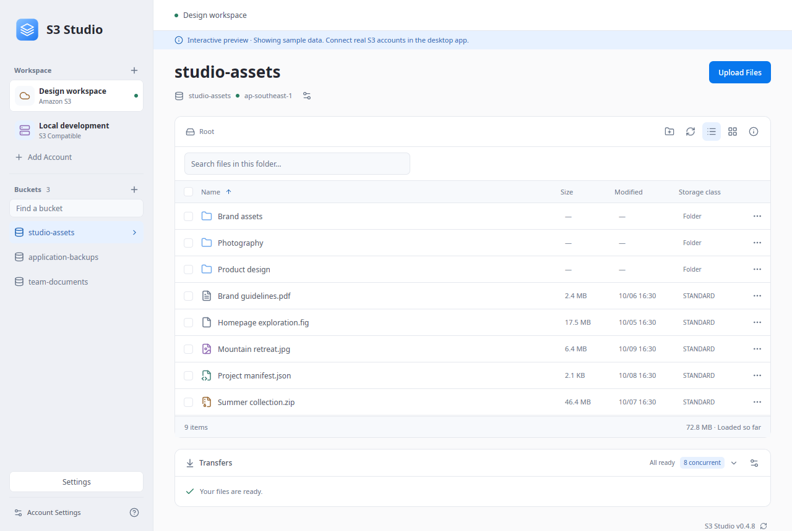

# S3 Studio

[简体中文](README.md) · [English](README.en.md) · [한국어](README.ko.md) · [日本語](README.ja.md) · [Français](README.fr.md) · [Deutsch](README.de.md) · [Русский](README.ru.md)

S3 Studio 是一款跨平台桌面 S3 客户端，让云端文件管理更直观。连接 AWS S3、MinIO 或其他 S3 兼容服务，在一个工作空间中管理多个账户、浏览存储桶、上传下载文件。

支持 **macOS、Windows、Ubuntu 和 Omarchy / Arch Linux**，账户数量不设上限，凭据保存在本机系统密钥库。



## 产品功能

- **多账户管理**：添加、编辑和切换账户，支持自定义 Endpoint、Region、路径风格和临时凭据。
- **文件浏览**：文件夹与面包屑导航、搜索、排序、列表、网格和树状视图，以及多选和对象详情。
- **文件操作**：上传、下载、新建文件夹和存储桶、同桶复制、批量删除及生成分享链接。
- **传输管理**：查看进度和速度，暂停、继续、失败重试，应用重启后可从断点继续。
- **共享并发**：所有账户的上传和下载共同使用并发上限，默认 8 路，可调整为 1–32 路。
- **外观与语言**：亮色、暗色或跟随系统；简体中文、English、한국어、日本語、Français、Deutsch、Русский 或跟随系统语言。
- **本地凭据**：使用 macOS Keychain、Windows Credential Manager 或 Linux Secret Service 保存密钥。

## 下载与安装

从 [GitHub Releases 下载最新版](https://github.com/eyotang/s3studio/releases/latest)，选择对应平台的安装包。每次发布附带 `SHA256SUMS.txt`，可用于核对下载文件。

| 平台                            | 安装包           | 安装方式                            |
| ------------------------------- | ---------------- | ----------------------------------- |
| macOS 14+ Apple Silicon / Intel | Universal `.dmg` | 打开后将 S3 Studio 拖入「应用程序」 |
| Windows x64                     | `.exe` / `.msi`  | 运行安装程序                        |
| Ubuntu 22.04+ amd64             | `.deb`           | 使用系统软件安装器安装              |
| Linux x86_64                    | `.AppImage`      | 添加执行权限后运行                  |
| Omarchy / Arch Linux x86_64     | `.pkg.tar.zst`   | 使用 `pacman -U` 安装               |

当前安装包尚未配置系统代码签名，macOS 尚未进行 Apple 公证，系统可能提示来源无法验证。

### macOS 无法打开应用

将 S3 Studio 放入「应用程序」文件夹，核对官方 Release 来源及 SHA-256 后，在终端执行：

```bash
sudo xattr -d com.apple.quarantine "/Applications/S3 Studio.app"
```

然后从「应用程序」启动 S3 Studio。

### Linux 安装说明

Ubuntu / Arch 需要运行并解锁支持 Secret Service 的密钥库（如 GNOME Keyring），并提供桌面文件选择 portal。

AppImage 下载后，在文件属性中允许作为程序执行，再双击打开。

Omarchy / Arch 下载对应版本的 `.pkg.tar.zst`，在终端输入 `sudo pacman -U `，将安装包拖入终端补全路径后执行。安装后从应用启动器打开 **S3 Studio**，也可运行 `s3-studio`。卸载使用 `sudo pacman -R s3-studio`，不会删除个人账户和传输配置。

Omarchy 包尚未加入 AUR 或 Omarchy 软件仓库，目前支持 x86_64。升级时从发布页下载新包，再用 `pacman -U` 安装。0.3.0 的补充包使用独立的 `SHA256SUMS-Omarchy.txt` 校验清单。

## 开始使用

### 连接账户

点击侧栏「添加账户」，输入名称、Access Key ID、Secret Access Key 和 Region。

工作空间卡片右上角的竖向省略号菜单提供「更新」和「删除」。删除前，弹窗会显示选中的工作空间名称。确认后只移除该工作空间在本机保存的连接配置和凭据。

AWS 一般不填 Endpoint；访问桶时自动探测实际区域。临时凭据需同时输入 Session Token；更新 Access Key / Secret Key 时可以留空 Token 来清除原有 Token。编辑账户时两个密钥同时留空，会保留完整原有凭据。

MinIO 例子：Endpoint 为 `http://localhost:9000`，Region 为 `us-east-1`，勾选「使用路径风格访问」。正式环境建议使用 HTTPS。

账户需要相应的 S3 权限：列出桶需要 `s3:ListAllMyBuckets`，浏览需要 `s3:ListBucket`，文件操作需要 `s3:GetObject`、`s3:PutObject`、`s3:DeleteObject`；恢复分片上传需要 `s3:ListMultipartUploadParts`，取消清理需要 `s3:AbortMultipartUpload`，建桶需要 `s3:CreateBucket`。下载版本控制桶的固定对象版本可能需要 `s3:GetObjectVersion`。复制需要源对象读取和目标写入权限；为防止覆盖，复制前会检查目标对象是否存在。权限不足会在界面显示服务错误。

选择文件后，搜索栏右侧提供下载、复制、分享和删除操作。目录也可直接选中删除，确认后递归删除全部子目录和文件，支持多目录与文件混合选择。后端完整分页枚举，以每批最多 1000 个对象删除；目录标记最后删除，部分失败会显示失败路径。双击文件夹进入，双击文件显示对象详情。

在对象搜索框输入或粘贴完整路径，停顿片刻后，精确命中就会自动跳转。`reports/2026/` 会打开当前桶的目录，`s3://my-bucket/reports/2026/report.csv` 会进入当前账户中对应桶的父目录，选中对象并显示详情。从桶根目录输入带扩展名的完整文件名也会尝试定位。路径区分大小写，定位直接向 S3 核对键或目录前缀，目标可以位于尚未加载的页。跳转后可以接着输入更深的路径。普通关键词或未命中的路径会继续筛选。点搜索框内右侧的叉可清空输入。按回车可以手动核对。对象键本身以 `/` 结尾时，在搜索框按 `Shift+Enter`，再勾选「仅定位对象」。

点击对象工具栏的「树状视图」扫描当前目录及其子目录。在根目录打开树状视图可统计整个桶。点击目录名展开或折叠，每一行显示大小、对象数和占父目录的比例，默认按大小降序。搜索会自动展开匹配对象的上级目录，大小和占比仍以完整扫描结果为准。统计涵盖当前可见的对象数据，历史版本和未完成的分片上传不计入。扫描可以取消，点击「刷新」可重新统计。

树状视图将对象键和目录汇总保存在本机 SQLite 缓存中，按页读取展开的目录和搜索结果。缓存可跨重启复用，已扫描的上级目录也可为子目录提供数据。窗口底部显示上次扫描时间，满 24 小时或发现无法确认的变更时会提示刷新。应用内确认的上传、复制、新建目录和删除会更新已有缓存，其他客户端的改动可通过「刷新」同步。首次扫描和手动刷新会完整列举当前范围，大桶的缓存需要相应的磁盘空间。

首次建立缓存时，可先浏览当前层级和展开的子目录。完整统计在后台进行，目录会显示「计算大小中…」，文件大小会直接显示。统计完成前，搜索范围为已加载的目录页。取消统计后仍可浏览，点击「重新扫描」可重新开始统计。手动刷新已有缓存时，仍可查看上次的汇总。

### 语言、主题与并发设置

从侧栏底部打开「设置」，macOS 也可使用「S3 Studio → 设置…」或 ⌘,。

- 语言：跟随系统、简体中文、English、한국어、日本語、Français、Deutsch 或 Русский。
- 主题：跟随系统、亮色或暗色，默认跟随系统并响应外观变化。
- 并发：输入 1–32 的整数，点击「保存设置」生效。

语言和主题立即生效并自动保存，重启后保留。自动识别中文、英文、韩语、日语、法语、德语和俄语系统，其他语言使用英文；账户名、对象键和服务端原始错误保留原文。

### 传输与断点续传

所有账户的上传和下载共享并发上限，默认 8 路。提高上限会增加后续调度；降低上限时，已开始的分片先完成，再按新上限执行。文件不足一个分片时只能占用一路。

在「传输活动」中可暂停、继续、重试或取消任务。暂停会保留成功的分片，继续时校验断点并补传缺少的分片。关闭应用后，下次启动将未结束任务显示为「已暂停」，需手动点击继续。

暂停和失败保留断点；取消任务会清理断点及对应的临时内容。存在未结束任务时，需先处理任务才能移除账户。源文件、远端对象或下载目标发生变化时，应用会阻止不安全的续传或覆盖，可取消旧任务后重新发起。

### 软件更新

通过 macOS「S3 Studio → 检查更新…」或底栏版本号手动检查更新。发布版启动 20 秒后自动检查，此后每 24 小时检查；自动检查失败静默重试，手动检查会显示错误。

Windows NSIS / MSI 安装版和 Linux AppImage 支持在应用内下载、校验并安装更新。安装前需暂停或完成所有传输，更新期间不能新增或恢复传输。

macOS、Ubuntu deb 和直接运行的可执行文件会打开对应发布页，下载新版后手动安装。账户配置和传输断点会保留。0.2.2 首次升级需手动安装 0.2.3。

## 使用范围与限制

单文件上传上限为 5 TiB，单次服务端复制受 S3 CopyObject 的 5 GB 限制。大文件上传时请勿修改源文件；实际传输速度取决于网络、磁盘和服务端限制，并发并不保证按路数线性提升。

删除目录会递归删除其中所有当前可见对象，不清除版本控制桶的历史版本；删除前有明确确认。目录先完整枚举后删除，枚举完成后新上传的对象不会被此次删除，请避免删除期间向同一目录写入。上传会覆盖当前目录中的同名对象；版本控制桶的恢复行为由服务端设置决定。分享链接有效期也受临时凭据到期时间影响。

首版暂不包含 SSO/AssumeRole、ACL/策略编辑、版本管理、跨账户复制、目录同步、Glacier 恢复、文件夹批量下载以及 CloudFront 管理。S3 兼容服务的具体 API 兼容程度需以实际联调为准。

## 开发与贡献

本项目使用 **Native Shell + Rust + AWS SDK for Rust**。`src-nsh` 提供原生桌面界面和打包配置，`src-core` 提供账户、S3 和传输后端。

### 开发环境与启动

- 最新稳定版 Rust（最低 1.97；原生依赖固定在 `src-nsh/Cargo.lock`，共享后端测试依赖固定在 `src-core/Cargo.lock`）。
- Windows：MSVC C++ Build Tools。
- macOS 14+：Xcode Command Line Tools。
- Ubuntu：以下原生开发依赖；桌面会话中需要运行且解锁支持 Secret Service 的密钥库，如 GNOME Keyring。

```bash
sudo apt-get update
sudo apt-get install -y build-essential file libdbus-1-dev gnome-keyring libxcb1-dev libxkbcommon-dev libxkbcommon-x11-dev libwayland-dev libvulkan-dev libfontconfig1-dev libasound2-dev libx11-xcb-dev libxi-dev libxrandr-dev libxinerama-dev libxcursor-dev libclang-dev
```

使用 Cargo 启动桌面应用。

```bash
cargo run --locked --manifest-path src-nsh/Cargo.toml
```

也可以使用示例数据预览原生界面。

```bash
cargo run --locked --manifest-path src-nsh/Cargo.toml -- --preview
```

### 检查与构建

原生交互使用 Native Shell 的无头测试驱动验证。签名测试、打包和发布脚本使用 Node.js 22.12+ 的标准库。

```bash
cargo test --locked --manifest-path src-core/Cargo.toml
cargo test --locked --manifest-path src-nsh/Cargo.toml
node --test tests/update-signature.test.mjs
```

在目标操作系统上构建 NSH 可执行文件并生成安装包。Linux 需要 `dpkg-deb` 和 GitHub CLI，打包脚本会下载并校验 AppImage 工具。Windows 需要 PowerShell 7、NSIS 3.11 和 WiX Toolset 3.14.1。

```bash
node scripts/build-native.mjs
node scripts/package-native.mjs
```

macOS 使用 AppKit，Windows 使用 Win32，Linux 使用 Native Shell 的 GPUI 渲染后端。各平台使用原生打包工具，沿用原有应用 ID 和更新签名格式。安装包输出到 `src-nsh/target/installer/bundle/`，包括 Windows NSIS/MSI、Linux deb/AppImage 和 macOS Universal DMG。

macOS 构建前通过 `rustup target add aarch64-apple-darwin x86_64-apple-darwin` 安装两个目标。使用 `node scripts/build-native.mjs --universal` 构建，再执行 `node scripts/package-native.mjs` 生成 Universal DMG。

推送与应用版本一致的 `v<版本号>` 标签后，工作流等待三平台测试与构建全部通过，汇总六个安装包（含 Omarchy）、三份更新签名和 `latest.json`，生成 SHA-256 校验清单，先上传到草稿 Release，核对远端文件数量和大小后再正式发布。Windows 和 AppImage 更新包使用专用密钥签名，macOS 正式安装包使用固定的项目自签名证书。

Omarchy 包复用同版本 deb 中的原生可执行文件，通过 Arch 的 `makepkg` 生成，安装后使用系统动态库，不需要 FUSE。Linux CI 使用 `bash scripts/build-omarchy.sh <本仓库内的.deb路径> artifacts/omarchy` 构建与验证，需要 Docker。`Supplement release with Omarchy package` 工作流用于给当前已发布版本补包，不覆盖已有附件、更新清单或签名。

### 数据与传输实现

账户元数据文件继续使用原版的应用数据目录，文件名 `accounts.json`；凭据位于系统密钥库，服务名 `com.s3studio.desktop`，每个账户使用独立 UUID。

分片默认 16 MiB，超大文件会增大分片以保持不超过 10,000 片。非空文件使用 Multipart Upload，下载使用带 ETag 条件的 Range 请求；每路缓冲区约 256 KiB，不按完整分片大小分配内存。上传进度与速度按分片完成更新，下载进度按读取字节更新。

「暂停」会停止当前未完成的分片，保留已经成功的分片；「继续」和「重试」会校验断点并补传缺少的分片。未完成分片重新传输，因此并非精确到每个字节续传。关闭应用后，下次启动将未结束任务显示为「已暂停」，点击继续即可恢复，不自动开始网络传输。

配置和传输记录保存在应用数据目录的 `transfers.json`，包含并发上限、文件路径、UploadId、ETag、已完成分片信息和校验摘要，不包含 AK / SK / Token。下载内容保存在目标目录旁的 `.s3studio-<任务 UUID>.part` 文件。取消上传会请求 AbortMultipartUpload，取消下载会删除临时文件；暂停和失败保留断点，清除完成记录不会移除暂停或失败任务。存在未结束任务时不能移除其账户。

上传恢复时核对服务端 ListParts 和本地文件 SHA-256；下载恢复时校验已完成本地分片的 SHA-256，并固定 VersionId 或使用 ETag 检测对象变化。源文件或远端对象变化会阻止续传，保存位置被其他程序修改会阻止覆盖。请取消旧任务后重新发起。服务端生命周期规则若清理了未完成上传，原 UploadId 不能继续使用。

应用数据目录：Windows 为 `%APPDATA%/com.s3studio.desktop`，macOS 为 `~/Library/Application Support/com.s3studio.desktop`，Ubuntu 为 `$XDG_DATA_HOME/com.s3studio.desktop`（默认 `~/.local/share/com.s3studio.desktop`）。

### 发布与验证

更新签名继续使用已有的 Minisign 密钥。GitHub Actions 将现有仓库 Secret 传给独立签名工具，公钥固定在 `packaging/app.json`。发布脚本会校验三份更新包的签名和绑定的版本。更新清单由本仓库 Release 的 `latest.json` 提供。

macOS 正式发布使用 GitHub Actions 中的 `S3_STUDIO_MACOS_SIGNING_P12`（Base64 编码的 PKCS#12）和 `S3_STUDIO_MACOS_SIGNING_PASSWORD`。打包会核对 `packaging/app.json` 中的证书指纹，并验证通用包的两种架构。发布时复用同一证书和 Bundle ID，以延续钥匙串授权。macOS CI 会用临时钥匙串验证第二个构建无需交互即可读取第一个构建写入的凭据。

Windows Release 构建后可运行 `powershell -NoProfile -File scripts/smoke-desktop.ps1` 检查原生程序启动；测试会结束自己启动的进程，报告保存到 `artifacts/native-startup.json`。

测试覆盖并发配置保存与动态调整、本地模拟 S3 的签名、完整分页递归删除、部分删除失败、共享并发限制、上传/下载暂停恢复、损坏断点校验、文件变化保护、提交后重启恢复、更新期间传输保护，以及更新包签名、公钥与版本绑定。Windows 原生启动报告保存于 `artifacts/native-startup.json`。

测试不使用真实云账户；三平台构建分别验证安装包，原生界面在三平台执行无头交互测试。

发布时遵循 [AGENTS.md](AGENTS.md)，并维护 `docs/releases/<版本>.md` 中的版本说明。每个版本的 GitHub Release 描述必须包含 macOS 的 `xattr` 处理命令。

翻译文件位于 `src-core/locales/`，以中文原文为键。修改后运行 `node scripts/sync-i18n.mjs` 同步动态文案，再格式化 Rust 并运行测试。

### 参与贡献

欢迎提交 Issue 反馈问题或提出改进建议。问题反馈请附上应用版本、操作系统、复现步骤及相关错误信息；截图和日志请先移除凭据、账户信息等敏感内容。

提交 Pull Request 时，说明解决的问题、变更后的行为和验证结果。涉及界面的改动请附截图；根据改动范围运行上方相应检查。测试使用本地模拟 S3 服务，不依赖真实云账户。

### 项目参考与品牌资源

本项目参考 S3 Browser 的公开功能，桌面界面使用 Native Shell，S3 请求由 AWS SDK for Rust 完成。[S3 Browser](https://s3browser.com/) · [Native Shell](https://nsh.dev/docs/rust/) · [AWS SDK for Rust](https://docs.aws.amazon.com/sdk-for-rust/latest/dg/welcome.html)

Logo 以 Apple Design 的留白和几何层级为参考，保留浅蓝色圆角底，采用三层等距几何线条表达对象存储。侧栏、桌面与安装包使用同一标志。SVG 源文件和设计说明位于 `assets/brand/`，桌面 PNG / ICO / ICNS 位于 `src-nsh/icons/`。
