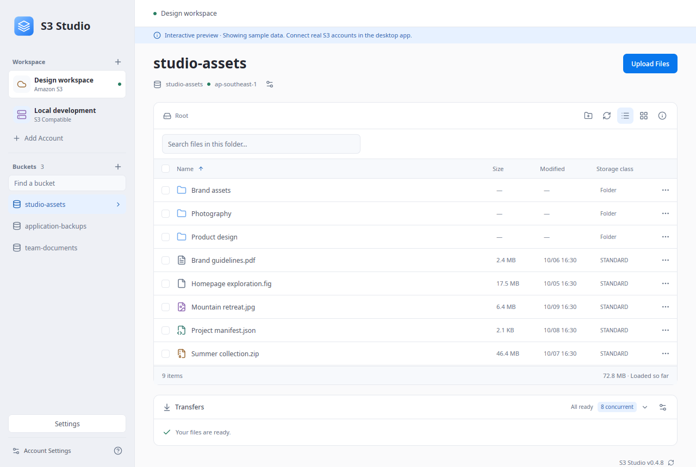

# S3 Studio

[简体中文](README.md) · [English](README.en.md) · [한국어](README.ko.md) · [日本語](README.ja.md) · [Français](README.fr.md) · [Deutsch](README.de.md) · [Русский](README.ru.md)

S3 Studio — кроссплатформенный настольный клиент S3 для удобного управления облачными файлами. Подключайте AWS S3, MinIO и другие S3-совместимые сервисы, работайте с несколькими аккаунтами и бакетами, загружайте и скачивайте файлы. Число аккаунтов не ограничено, а учётные данные хранятся в системной связке ключей.



## Возможности

- Несколько аккаунтов с собственными Endpoint, Region, адресацией в стиле пути и временными учётными данными.
- Навигация по папкам и пути, поиск, сортировка, список и сетка, множественный выбор и сведения об объектах.
- Загрузка, скачивание, создание папок и бакетов, копирование внутри бакета, массовое удаление и подписанные ссылки.
- Прогресс и скорость передачи, пауза, продолжение, повтор и возобновление после перезапуска приложения.
- Общий предел параллельных операций для всех аккаунтов: 8 по умолчанию, от 1 до 32 в настройках.
- Системная, светлая и тёмная темы; китайский, английский, корейский, японский, французский, немецкий и русский языки.
- Хранение учётных данных в macOS Keychain, Windows Credential Manager или Linux Secret Service.

## Скачивание и установка

Скачайте последнюю версию с [GitHub Releases](https://github.com/eyotang/s3studio/releases/latest). Перед установкой проверьте файлы по `SHA256SUMS.txt`, приложенному к выпуску.

| Платформа                       | Пакет            | Установка                                             |
| ------------------------------- | ---------------- | ----------------------------------------------------- |
| macOS 14+ Apple Silicon / Intel | Universal `.dmg` | Перетащите S3 Studio в Программы                      |
| Windows x64                     | `.exe` / `.msi`  | Запустите установщик                                  |
| Ubuntu 22.04+ amd64             | `.deb`           | Откройте системным установщиком пакетов               |
| Linux x86_64                    | `.AppImage`      | Разрешите выполнение и запустите                      |
| Omarchy / Arch Linux x86_64     | `.pkg.tar.zst`   | Установите через `sudo pacman -U`, указав путь пакета |

### Если macOS не открывает приложение

Приложение macOS подписано сертификатом Apple Developer ID, но ещё не прошло нотариальное заверение Apple. Переместите приложение в Программы, проверьте официальный источник выпуска и SHA-256, затем выполните:

```bash
sudo xattr -d com.apple.quarantine "/Applications/S3 Studio.app"
```

В Linux запустите и разблокируйте хранилище с поддержкой Secret Service, например GNOME Keyring. Нужен также портал выбора файлов рабочего стола. Разрешите запуск AppImage в свойствах файла. Пакет Omarchy пока не размещён в AUR: скачивайте новые пакеты и обновляйте через `pacman -U`. Удаление командой `sudo pacman -R s3-studio` сохраняет личные настройки.

## Начало работы

### Подключение аккаунта

Выберите Добавить аккаунт и введите имя, Access Key ID, Secret Access Key и Region. Для AWS Endpoint обычно не нужен; регион бакета определяется автоматически. Для временных учётных данных нужен также Session Token. Пример MinIO: Endpoint `http://localhost:9000`, Region `us-east-1`, включена адресация в стиле пути. В рабочей среде используйте HTTPS.

Аккаунту нужны соответствующие права S3. Дважды щёлкните папку для перехода или файл для просмотра сведений. Выберите объекты для скачивания, копирования, отправки ссылки или удаления. Удаление папки после подтверждения рекурсивно удаляет её содержимое. Загрузка перезаписывает одноимённые объекты. Ссылки действуют 1 час, но могут истечь раньше вместе с временными учётными данными.

### Язык, тема и передачи

Откройте Настройки в боковой панели или через S3 Studio → Настройки… (⌘,) в macOS. Язык и тема применяются сразу и сохраняются локально. Режим Как в системе определяет поддерживаемый язык системы, а для остальных использует английский. Укажите 1–32 параллельные операции и сохраните настройки. Системный заголовок окна macOS следует выбранной теме.

В разделе Передачи доступны пауза, продолжение, повтор и отмена. При паузе завершённые части сохраняются. После перезапуска незавершённые передачи остаются на паузе до ручного продолжения. Отмена очищает точки возобновления и временные данные. Изменение исходного файла, удалённого объекта или файла назначения может заблокировать небезопасное возобновление или перезапись.

### Обновления и ограничения

Проверяйте обновления через меню приложения macOS или номер версии. Опубликованные сборки проверяют обновления через 20 секунд после запуска и затем каждые 24 часа. Windows NSIS/MSI и Linux AppImage поддерживают проверенную установку внутри приложения; сначала завершите или приостановите передачи. macOS и deb открывают страницу выпуска для ручной установки. Аккаунты и точки возобновления сохраняются.

Меню «Действия с файлами» поддерживает передачу папок, копирование и перемещение между бакетами и аккаунтами, переименование, предпросмотр, локальное редактирование, одностороннюю синхронизацию, фильтры, пакетную выдачу ссылок и изменение свойств объектов. Выбранные версии можно скачать или удалить. Максимальный размер загружаемого файла — 5 ТиБ. SSO/AssumeRole, управление ACL и политиками бакетов, извлечение из Glacier и администрирование CloudFront в этот выпуск не входят.

## Разработка и участие

Приложение использует Native Shell, Rust и AWS SDK for Rust. В `src-nsh` находятся нативный интерфейс и настройки упаковки. `src-core` содержит общий код для работы с S3, учётными записями и передачей файлов. Установите стабильный Rust, Xcode Command Line Tools на macOS или MSVC C++ Build Tools на Windows. Библиотеки Linux перечислены в [справочнике разработчика](README.md#开发与贡献).

```bash
cargo run --locked --manifest-path src-nsh/Cargo.toml
```

Добавьте `-- --preview`, чтобы запустить приложение с демонстрационными данными.

Запустите проверки, соответствующие вашим изменениям:

```bash
cargo test --locked --manifest-path src-core/Cargo.toml
cargo test --locked --manifest-path src-nsh/Cargo.toml
node --test tests/release-manifest.test.mjs
```

Запустите `node scripts/build-native.mjs` и `node scripts/package-native.mjs` на целевой ОС. Скрипты упаковки и публикации используют стандартную библиотеку Node.js 22.12+. Universal-сборки, пути данных и подписи описаны в [справочнике разработчика](README.md#开发与贡献). Измените переводы в `src-core/locales`, выполните `node scripts/sync-i18n.mjs`, отформатируйте Rust и запустите тесты.

В Issue укажите версию приложения, ОС, шаги воспроизведения и ошибки. Удалите учётные и личные данные из журналов и снимков экрана. В Pull Request опишите проблему, новое поведение и проверки; для изменений интерфейса приложите снимки. Тесты используют локальный симулятор S3. При публикации следуйте [AGENTS.md](AGENTS.md): сначала английский текст, затем китайский, с инструкцией macOS xattr в обеих частях.

Этот независимый проект не является официальным продуктом AWS. См. [технический справочник на китайском](README.md), [примечания к выпускам](docs/releases) и [материалы бренда](assets/brand).
